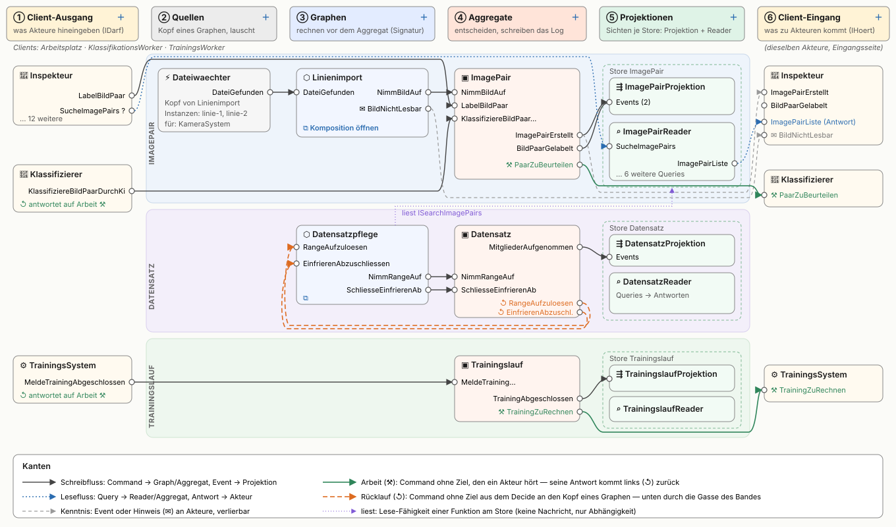
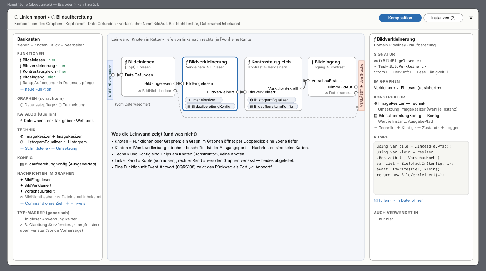

# Konzept: die Fläche der Werkbank in sechs Spalten

Stand 2026-11-04, Entwurf zur Abstimmung. Nach der Umsetzung wird dieses Dokument gelöscht (es bleibt im Git-Verlauf); die Beschreibung des
Ist-Zustands wandert dann nach `docs/10`.

## Worum es geht

Heute ordnet der Editor nach Domänen und Blöcken: je Domäne eine Region, darin ein Block je Aggregat, je Graph, ein Akteur-Band und ein
Geteilt-Band, und erst innerhalb eines Blocks laufen Rollen-Spalten von links nach rechts (Command, Decider, Aggregat, Event … Reader). Die Blöcke
werden wie Kisten in ein Regal gepackt. Den Ablauf der Anwendung liest man so nicht ab: rund 700 Kanten laufen quer über die Fläche, und über hundert
Nachrichten-Karten (Commands, Events, Queries, Antworten) stehen als eigene Karten zwischen allem.

Künftig ist die Fläche selbst der Ablauf. Jede Spalte ist eine thematische Einheit, und von links nach rechts liest man, was eine Nachricht durchläuft:
von dem, was Akteure hineingeben, über Quellen, Graphen und Aggregate zu den Projektionen und zurück zu dem, was bei den Akteuren ankommt. Was einen
Graphen innen zusammensetzt — Funktionen, Technik, Konfig, die Nachrichten, die nur Knoten einander geben — steht nicht auf dieser Fläche, sondern in
einem eigenen Kompositions-Modal.

## Die Hauptfläche

### Die sechs Spalten

1. **Client-Ausgang.** Je Akteur eine Karte mit dem, was er hineingeben darf (`IDarf`): Commands mit Ziel, Commands ohne Ziel, Queries, Hinweise.
   Jeder Eintrag ist ein Ausgangsport auf der rechten Kante. Über der Spalte stehen die Clients als Leiste; ein Klick auf einen Client markiert die
   Akteure, die er verkörpert.
2. **Quellen.** Je Quellknoten eines Graphen eine Karte: der Dateiwächter am Kopf des Linienimports, ein Taktgeber, ein Webhook oder eine eigene
   Funktion mit `Lausche`. Die Karte zeigt, wessen Kopf sie ist, ihre Instanzen mit den Werten (Verzeichnis, Takt) und den Akteur, für den die
   Instanz hineingibt. Im Code bleibt die Quelle, was sie ist: ein Knoten am Kopf des Graphen. Die Karte ist nur seine Lesart auf der Fläche.
3. **Graphen.** Je Graph eine Karte, die nur seine Signatur zeigt: links die Köpfe (was von außen hineinkommt), rechts was ihn verlässt. Ein Graph,
   der nur in einem anderen steckt (die Bildaufbereitung im Linienimport), steht nicht auf der Fläche, sondern im Modal seines Elternteils. ⧉ öffnet
   die Komposition.
4. **Aggregate.** Links die Commands, die es nimmt, und die Queries der direkten Abfrage; rechts die Events, die Hinweise, die Arbeit für Akteure und
   die Commands ohne Ziel, die das Decide an einen Graphen gibt.
5. **Projektionen.** Je Store ein Rahmen mit seinen Projektionen (links die Events, die sie hören) und Readern (links die Queries, rechts die
   Antworten). Handles, Store-Funktionen und Read-Model stehen nicht mehr als eigene Karten auf der Fläche, sondern im Inneren des Stores (siehe unten).
6. **Client-Eingang.** Dieselben Akteure ein zweites Mal, jetzt mit dem, was zu ihnen kommt (`IHoert`): Kenntnis (Events, Hinweise), Arbeit
   (Commands ohne Ziel) und die Antworten auf ihre Queries. Jeder Eintrag ist ein Eingangsport auf der linken Kante.

Ein Akteur steht also zweimal, links mit seinem Ausgang, rechts mit seinem Eingang. Das ist gewollt: genau so verläuft der Weg einer Nachricht, und
der Kreis über die ganze Breite (Arbeit geht rechts hinaus, die Antwort kommt links herein) wird durch das Zeichen ↺ an der linken Karte sichtbar,
statt als Kante quer über die Fläche.

### Domänen als Bänder

Die Domänen bleiben die oberste Gliederung, aber als waagrechte Bänder über die Spalten ② bis ⑤: das Band „ImagePair“ trägt den Linienimport, das
Aggregat ImagePair und den Store ImagePair, das Band „Datensatz“ die Datensatzpflege, das Aggregat Datensatz und seinen Store. Zu welcher Domäne eine
Karte gehört, rechnet wie heute der Server aus dem Graphen (`Sicht`), nicht aus dem Namespace. Die Akteure in ① und ⑥ stehen außerhalb der Bänder
über die ganze Höhe, denn ein Akteur spricht meist mit mehreren Domänen (das Trainingssystem meldet dem Trainingslauf und holt Samples aus dem Datensatz).

### Nachrichten sind Ports, keine Karten

Ein Command, ein Event, eine Query, eine Antwort oder ein Hinweis ist auf der Fläche ein beschrifteter Port an der Karte, die ihn erzeugt oder nimmt.
Die Kante läuft von Port zu Port. Damit fallen über hundert Karten weg, und jede Kante trägt ihren Typ von selbst.

Deklariert wird ein Nachrichtentyp an genau einer Stelle: am Port seines **Besitzers**. Wer das ist, rechnet der Server schon heute
(`Sicht.Besitz`): ein Command mit Ziel gehört seinem Aggregat, ein Event dem Aggregat, dessen Decide es ergibt, ein Command ohne Ziel der Funktion
bzw. dem Decide, das ihn ausgibt, eine Query und ihre Antwort dem Reader oder Aggregat, das antwortet, und was nur von außen kommt, dem Akteur, der es
darf. Ein Klick auf den Port öffnet die Felder im Panel; am fremden Ende einer Kante ist der Port nur ein Verweis. Wertobjekte und Enums erscheinen
ebenfalls nicht auf der Fläche, sondern im Panel ihres Besitzers bzw. als gemeinsame Begriffe in einem eigenen Modal (Kopfleiste „Begriffe“).

### Die Kanten

Sechs Arten, jede mit eigener Linie:

- **Schreibfluss** (durchgezogen): Command an Graph oder Aggregat, Event an Projektion.
- **Lesefluss** (blau gepunktet): Query an Reader oder Aggregat, Antwort an den Akteur.
- **Kenntnis** (grau gestrichelt): Event oder Hinweis an die Akteure, die ihn hören — verlierbar.
- **Arbeit** (grün): ein Command ohne Ziel, den ein Akteur hört; seine Antwort kommt links als ↺ zurück.
- **Rücklauf** (orange gestrichelt): ein Command ohne Ziel aus dem Decide an den Kopf eines Graphen. Beim Datensatz sind das `RangeAufzuloesen` und
  `EinfrierenAbzuschliessen`, die die Datensatzpflege nimmt und deren Ergebnis (`NimmRangeAuf`) wieder beim Datensatz ankommt.
- **liest** (lila, dünn): eine Funktion nutzt die Lese-Fähigkeit eines Stores (die Range-Auflösung sucht über `ISearchImagePairs`). Das ist keine
  Nachricht, nur eine Abhängigkeit.

Zwischen Nachbarspalten läuft eine Kante direkt. Was Spalten überspringt (der Inspekteur gibt `LabelBildPaar` direkt ans Aggregat, ein Hinweis aus
dem Linienimport geht direkt zum Akteur), läuft durch die Gasse oben oder unten im Band, Rückläufe immer unten. Lesefluss, Kenntnis und „liest“
stehen leise und werden hervorgehoben, sobald eine ihrer Karten gewählt ist; im bestehenden Menü „Ausblenden“ lässt sich jede Art abschalten.

### Anordnung und Gesten

Die Lage ist fest: Spalte und Band folgen aus dem Code, die Reihenfolge innerhalb einer Zelle rechnet der Editor so, dass sich möglichst wenige
Kanten kreuzen (Karten wandern zur mittleren Höhe ihrer Nachbarn). Von Hand darf eine Karte nur senkrecht innerhalb ihrer Zelle verschoben werden;
die Reihenfolge steht in der Ansicht (`.werkbank/ansicht.json`), wie heute die Positionen.

Die Zeile „＋ Aggregat ＋ Graph …“ entfällt; jede Spalte hat ihr ＋ im Kopf: ① ein Akteur, ② eine Quelle (aus dem Katalog oder als eigene Funktion
mit `Lausche`; legt einen Graphen mit dieser Quelle am Kopf an oder setzt sie vor einen bestehenden), ③ ein Graph, ④ ein Aggregat, ⑤ ein Store mit
Projektion oder Reader, ⑥ etwas, das ein Akteur hört. Wie heute verbindet man Port mit Port (⊕); ein Port ins Leere gezogen legt in der passenden
Spalte eine neue Karte mit diesem Eingang an.

Instanzen stehen als Chips an Graph- und Quellkarten und werden im Modal bearbeitet. Der Host-Rahmen rechts entfällt; Umgebung und Host bleiben in
der Kopfleiste.

## Das Kompositions-Modal

⧉ an einer Graph-Karte (oder Doppelklick) öffnet ein großes Modal über der abgedunkelten Fläche; Esc kehrt zurück. Oben stehen die Brotkrumen
(Linienimport ▸ Bildaufbereitung: ein Graph im Graphen öffnet per Doppelklick eine Ebene tiefer) und zwei Reiter, Komposition und Instanzen.

Die Mitte ist wieder ein Knoten-Editor, derselbe Zeichner wie auf der Fläche, kein Formular. Die Knoten stehen nach ihrer Tiefe in der Kette von links
nach rechts (Bildeinlesen → Bildverkleinerung → Kontrastausgleich → Bildeingang), je `[Von]` eine Kante, verlierbar gestrichelt. Der linke Rand
zeigt die Köpfe, also was von außen kommt, der rechte, was den Graphen verlässt und wohin (an ein Aggregat, an Akteure, an einen anderen Graphen).
Technik und Konfig sind Chips am Knoten, denn sie sind Konstruktor-Parameter und tauschen keine Nachrichten.

Links steht der **Baukasten**, aus dem man komponiert:

- **Funktionen** der Anwendung, mit Vermerk, wo sie schon stehen („hier“, „in Datensatzpflege“) — eine Funktion darf mehrfach vorkommen.
- **Graphen** zum Schachteln.
- **Katalog** des Frameworks: Dateiwächter, Taktgeber, Webhook.
- **Technik**: Schnittstellen mit ihren Umsetzungen (`IImageResizer` ← `ImageResizer`).
- **Konfig**-Records (`BildaufbereitungKonfig`).
- **Nachrichten im Graphen**: die Commands ohne Ziel, die nur Knoten einander geben (`BildEingelesen`, `BildVerkleinert`, `VorschauErstellt`), und die
  Hinweise. Sie gehören der Funktion, die sie ausgibt, und erscheinen deshalb nur hier.
- **Typ-Marker** für generische Funktionen: in der Sonde etwa `Glaettung<Kurzfenster>` und `Glaettung<Langfenster>` über `IFenster`, die dasselbe
  generische Command `Geglaettet<TFenster>` je Fenster ausgeben. Zieht man eine generische Funktion auf die Leinwand, fragt der Editor das
  Typargument ab.

Ziehen aus dem Baukasten legt einen Knoten an (ein Parameter im Graph-Record), Port auf Port schreibt ein `[Von]`, ein Chip auf einen Knoten
ergänzt dessen Konstruktor. Rechts steht das Panel des gewählten Knotens: Signatur von `Auf`, „bekommt von“ mit gesichert/verlierbar, Konstruktor
(Technik mit der Umsetzung, die die Instanz wählt, Konfig mit den Werten je Instanz, Zustand, Logger), der Rumpf als Code-Kachel mit 🤖 füllen und wo die
Funktion sonst noch verwendet wird.

Dieselbe Form bekommen in einem zweiten Schritt das Aggregat (Decider, Applier, Zustand, Fragen) und der Store (Projektions-Handles,
Store-Funktionen, Read-Model): außen die Signatur in ihrer Spalte, innen ein Modal.

## Was der Server liefert

Wie bisher rechnet der Server, der Editor zeichnet (W3). Die `Sicht` bekommt eine Lesart für die Fläche: je Karte Spalte und Band, ihre Ports (Typ,
Richtung, Besitzer oder Verweis) und die Kanten von Port zu Port mit ihrer Art. Für jeden Graphen kommt die Komposition hinzu: Knoten mit Tiefe,
Kanten, Köpfe, Ausgänge mit Ziel und der Inhalt des Baukastens (Funktionen mit ihren Verwendungen, Technik mit Umsetzungen, Konfig, interne
Nachrichten, Marker). Vieles davon gibt es schon (`Graphform`, `--graph`). Die Paritätsprüfung (`--check`) prüft zusätzlich, dass jede Nachricht
genau einen Besitzer-Port hat und jede Kante zwei Ports verbindet.

## Was wegfällt

Die Rollen-Spalten je Block (`ROLE_AGG`, `ROLE_SHARED`, `ROLE_AKTEUR`, `ROLE_GRAPH`), das Regal-Packen der Blöcke, der Inselkasten (eine Funktion,
die in keinem Graphen steht, findet man im Baukasten), die Nachrichten-, Handle- und Store-Fn-Karten auf der Fläche, die Rumpf-Kacheln auf der
Fläche (Rümpfe stehen im Panel und im Modal) und der Host-Rahmen. Technik wird nicht mehr als Funktions-Karte gezeichnet.

## Schritte

1. Server: Lesart der Fläche und der Komposition in der `Sicht`, `--check` erweitert.
2. Editor: Spalten, Bänder, Ports und die sechs Kantenarten; das alte `packLayout` fällt weg.
3. Kompositions-Modal für Graphen, mit dem bestehenden Knoten-Zeichner.
4. Gesten an den Spaltenköpfen und im Modal (Schreiber und `GestenDienst`).
5. Dieselbe Innenansicht für Aggregat und Store.
6. Abnahme: vom leeren Board einen Ablauf über alle sechs Spalten entwerfen, bauen, durchspielen (`Werkbank.Abnahme.Tests` angepasst).

## Offene Entscheidungen

- **Nachrichten als Ports.** Das löst die bisherige Regel „ein Typ wird nur an seiner eigenen Karte deklariert“ ab: der Ort ist künftig der Port
  seines Besitzers. Empfehlung: so machen.
- **Rümpfe nur noch im Panel und Modal**, nicht mehr als Kacheln auf der Fläche. Empfehlung: ja, die Fläche zeigt den Ablauf.
- **Gemeinsame Begriffe** (Wertobjekte, Enums, die mehrere nutzen) in einem eigenen Modal statt auf der Fläche. Empfehlung: ja.
- **Hand-Anordnung nur senkrecht** innerhalb der Zelle. Empfehlung: ja, sonst zerfällt die Spaltenordnung.
- **Leere Domäne**: ein Band ohne Karten bleibt als leeres Band stehen, bis etwas hineinkommt (heute die leere Domänen-Kachel).
